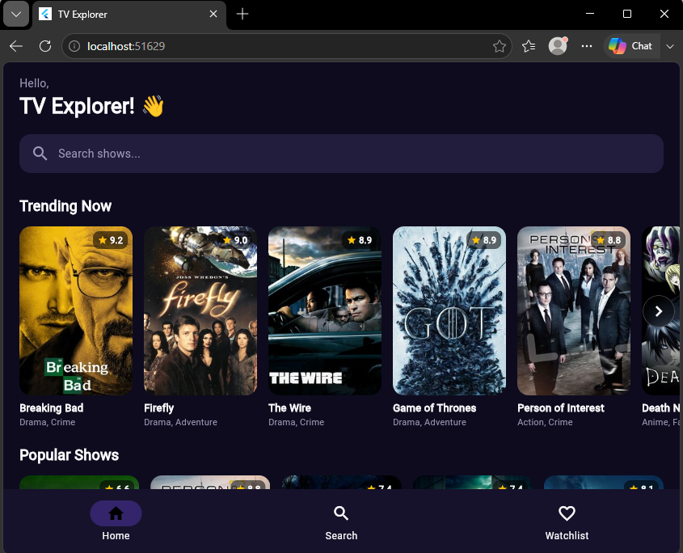
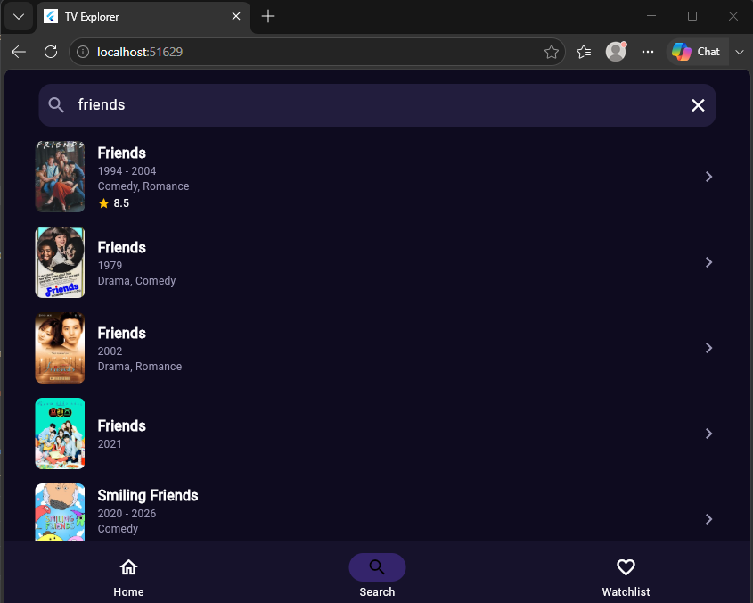
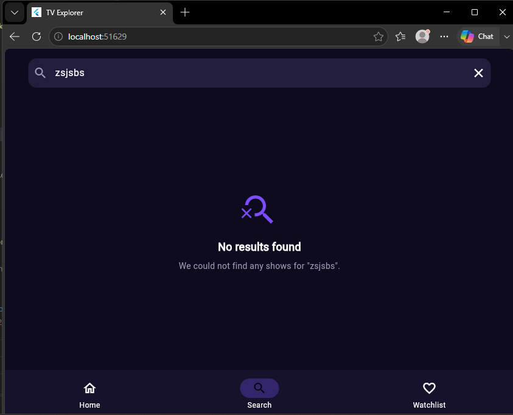
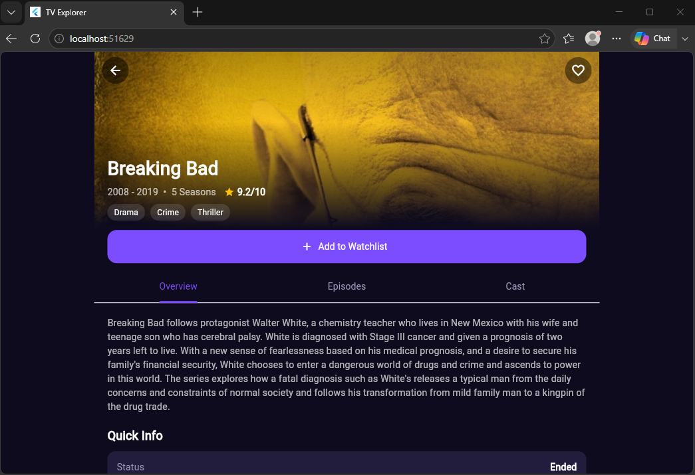
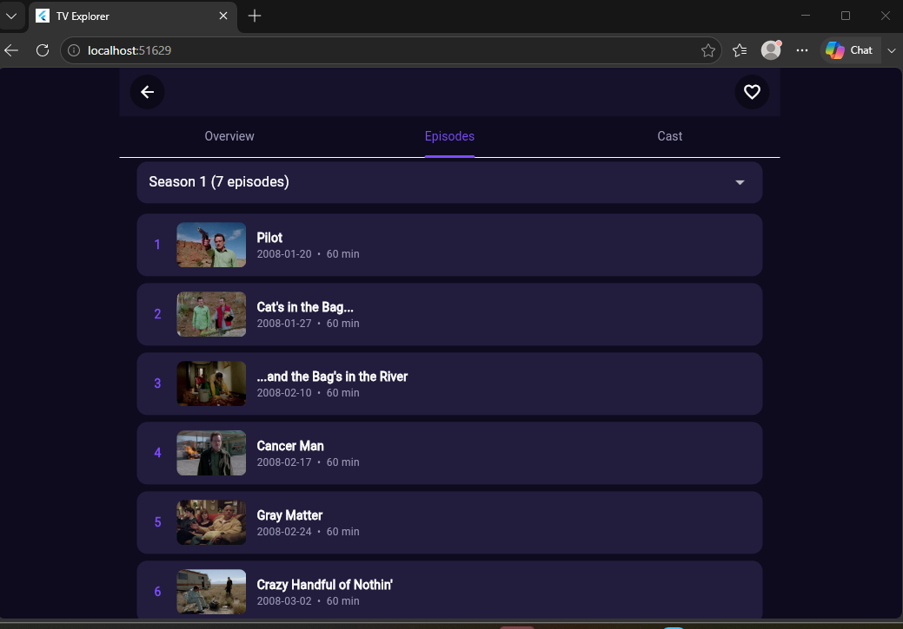
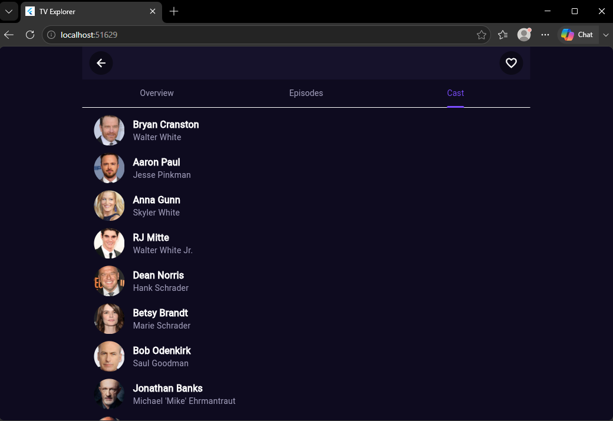
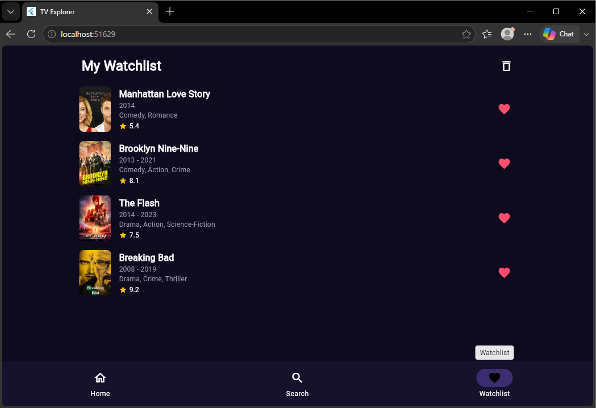
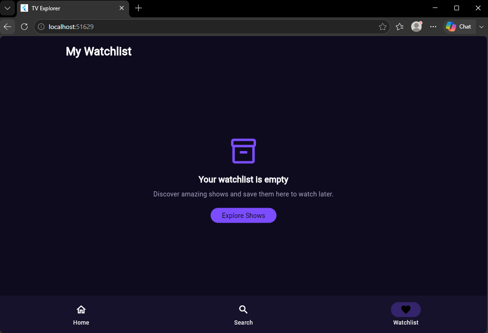

# TV Explorer

A TV show discovery app built with **Flutter** and the **BLoC** pattern, using the public [TVMaze API](https://www.tvmaze.com/api).

- **Course:** CS4039 – Software for Mobile Devices, Assignment 02
- **Author:** Muhammad Hammad Shaikh (K230779)

## Features

- Browse TV shows with posters, titles, genres and ratings
- **Trending Now** row (the best-rated shows from the loaded page) with left and right arrow buttons
- **Pagination:** more shows load automatically as you scroll
- **Search** by show name, with a 500 ms debounce so the API is not called on every key press, and a clear "No results found" message
- **Show details:** poster, title, summary, rating, genres and quick info (status, network, language, runtime, premiere date)
- **Cast** list and **episodes grouped by season** (season dropdown)
- **Watchlist:** add or remove a show from the details page, saved locally with SharedPreferences, and still there after restarting the app
- Loading indicators, empty states and error states with a "Try again" button
- Missing data is handled gracefully (no poster, no summary, no cast, no episodes)

No show data is hardcoded. Everything comes from the TVMaze API.

## Screenshots

<table>
  <tr>
    <td align="center"><br><b>Home</b></td>
    <td align="center"><br><b>Search results</b></td>
    <td align="center"><br><b>No results</b></td>
  </tr>
  <tr>
    <td align="center"><br><b>Details: Overview</b></td>
    <td align="center"><br><b>Details: Episodes by season</b></td>
    <td align="center"><br><b>Details: Cast</b></td>
  </tr>
  <tr>
    <td align="center"><br><b>Watchlist</b></td>
    <td align="center"><br><b>Empty watchlist</b></td>
    <td></td>
  </tr>
</table>

## Tech stack

| Package | Why it is used |
|---|---|
| `flutter_bloc` | BLoC state management (`Bloc`, `BlocProvider`, `BlocBuilder`, `BlocListener`) |
| `equatable` | Value equality for events, states and models, so unchanged states do not rebuild the UI |
| `http` | Calls to the TVMaze API |
| `shared_preferences` | Saves the watchlist locally |
| `bloc_concurrency` | Event transformers: `droppable` (pagination), `restartable` (search debounce), `sequential` (watchlist) |

## API endpoints used

| Feature | Endpoint |
|---|---|
| Get TV shows | `https://api.tvmaze.com/shows?page=0` |
| Load more shows | `https://api.tvmaze.com/shows?page=1` (and so on) |
| Search shows | `https://api.tvmaze.com/search/shows?q=dark` |
| Show details | `https://api.tvmaze.com/shows/{id}` |
| Show cast | `https://api.tvmaze.com/shows/{id}/cast` |
| Show episodes | `https://api.tvmaze.com/shows/{id}/episodes` |

TVMaze has no "trending" endpoint, so the Trending Now row shows the best-rated shows from the first loaded page.

## Architecture

The project follows a layered structure with one bloc per feature.

```
lib/
├── main.dart
├── data/
│   ├── api_client.dart          # the single HTTP call + error handling
│   ├── shows_api.dart           # home: /shows?page=
│   ├── search_api.dart          # search: /search/shows?q=
│   ├── details_api.dart         # details, cast, episodes
│   └── watchlist_storage.dart   # SharedPreferences
├── domain/
│   ├── show.dart
│   ├── cast_member.dart
│   └── episode.dart
└── presentation/
    ├── management/
    │   ├── home/bloc/       (bloc.dart, event.dart, state.dart)
    │   ├── search/bloc/
    │   ├── details/bloc/
    │   └── watchlist/bloc/
    └── ui/
        ├── main_shell.dart      # bottom navigation
        ├── home_page.dart
        ├── search_page.dart
        ├── details_page.dart
        ├── watchlist_page.dart
        ├── theme/
        └── widgets/
```

### Data flow

```
UI  ->  Event  ->  Bloc  ->  data layer (API / storage)  ->  new State  ->  UI rebuilds
```

- **UI** widgets only send events and draw states. API calls are never made inside widgets.
- **Events:** each bloc has one event class that carries an `action` enum, for example `ShowsEvent(loadMore)`.
- **Blocs** hold all the rules (pagination, debounce, grouping episodes by season, toggling the watchlist).
- **States** are plain data snapshots for the screen (status, lists, error message).

| Bloc | Actions | What it does |
|---|---|---|
| `ShowsBloc` (home) | `load`, `loadMore`, `retryLoadMore` | Loads page 0, then more pages while scrolling, and picks the Trending list |
| `SearchBloc` | `query`, `clear` | Debounced search with loading, success, empty and failure states |
| `DetailsBloc` | `load`, `selectSeason` | Fetches details, cast and episodes together and groups episodes by season |
| `WatchlistBloc` | `load`, `toggle`, `clear` | Adds and removes shows and saves the list |

### How the watchlist is kept after restart

After every change, `WatchlistBloc` saves the list through `WatchlistStorage`: each show is converted to JSON and stored as a list of strings in SharedPreferences. When the app starts, the bloc loads and decodes the saved list and emits it as its first state.

### Error handling

`ApiClient` turns no internet, timeouts, rate limiting (429), server errors and invalid data into a readable `ApiException`. Each bloc catches it and emits a failure state, and the screen shows an error view with a **Try again** button. Failed "load more" requests show a retry button at the bottom of the list.

## Setup

### Prerequisites

- [Flutter SDK](https://docs.flutter.dev/get-started/install) (stable channel, Dart 3 or newer)
- Git
- Chrome or Edge, an Android emulator, or Windows desktop support
- An internet connection (the app loads its data from the TVMaze API)

### Run the app

```bash
git clone https://github.com/k230779-gif/TV_Explorer_Hammad22z.git
cd TV_Explorer_Hammad22z
flutter pub get
```

Then run it on one device:

```bash
# Web (use a fixed port so the saved watchlist is found again on the next run)
flutter run -d chrome --web-port=5000

# Windows desktop
flutter run -d windows

# Android emulator (start the emulator first)
flutter run
```

Use `flutter devices` to see the available devices. On the web, the watchlist is stored in the browser for the address it runs on, which is why the port is fixed.

### Check the code

```bash
flutter analyze
```